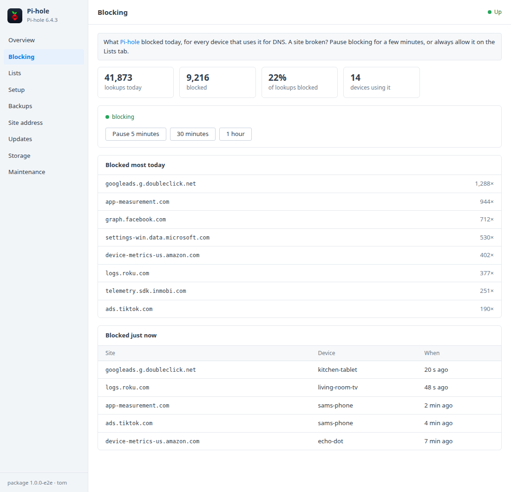
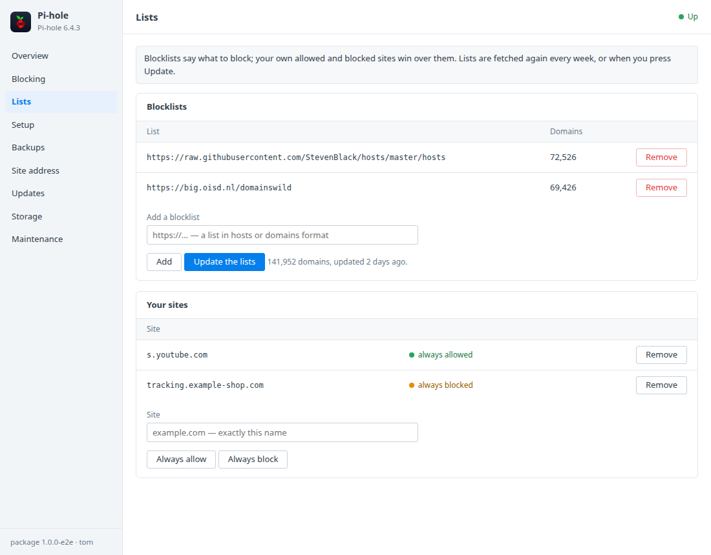
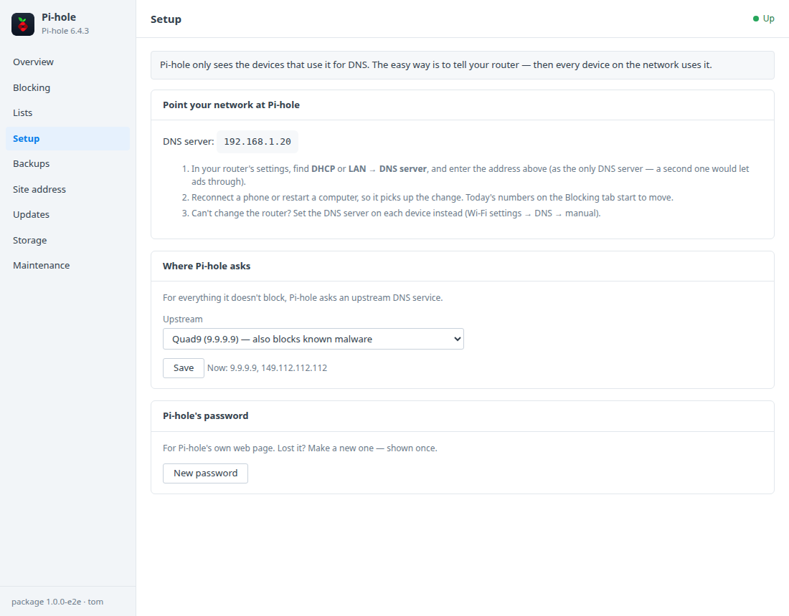

# Pi-hole for Synology DSM

A DSM 7 package that installs [Pi-hole](https://pi-hole.net) in Container
Manager. Pi-hole blocks ads, trackers and known bad sites for every device on
your network (phones, TVs, consoles) by answering their DNS lookups from your
Synology. A DSM window adds:
- what's being blocked, and pausing blocking for a while;
- blocklists, and sites you always allow or block;
- the upstream DNS;
- how to point your router at it;
- passwords, HTTPS, backups and updates.

Built on the [DSM app chassis](https://github.com/tombruton87/dsm-app-chassis).

## Download

### **[⬇ Download pihole.spk](https://github.com/tombruton87/pihole-dsm/releases/latest/download/pihole.spk)**

[](https://github.com/tombruton87/pihole-dsm/releases/latest)

That link always gives the newest version. Older ones are on the
[Releases](https://github.com/tombruton87/pihole-dsm/releases) page.

Install: Package Center → Manual Install → the `.spk` (DSM 7.2.1+; Container
Manager is installed first if missing). The wizard asks for the NAS's address,
a port for Pi-hole's web page (8089 by default), a time zone, the DNS port and
HTTPS. Pi-hole's password is made at the first start and shown once in the
window.

**Port 53 must be free on the Synology.** Routers and devices only ask DNS
servers on port 53. On a Synology that's free unless DSM's **DNS Server**
package is running. If it is, stop it before installing (Package Center →
DNS Server → Stop); the log says so plainly if it's in the way.

Then point your network at it. In your router's DHCP/LAN settings, set the DNS
server to the Synology's address, as the only DNS server. The Setup tab walks
you through it.

## What the DSM window adds

- **Blocking**
  - Lookups and blocked lookups today, the share blocked, and devices using
    Pi-hole.
  - **Pause** for 5 minutes, 30 minutes or an hour (it comes back by itself),
    or turn it back on.
  - The sites blocked most today, and those blocked just now.
- **Lists**
  - The blocklists (add one by address, remove one).
  - **Update the lists** (gravity).
  - **Your sites:** always allow, or always block, a site.
- **Setup**
  - The DNS server address for your router, step by step.
  - The upstream DNS: Cloudflare, Quad9 (which also blocks known malware),
    Google, or your own.
  - **New password** for Pi-hole's own page (shown once).
- **When blocking stays off** — if blocking has been off for an hour with no
  timer, DSM notifies its administrators.
- **Site address** — HTTPS for Pi-hole's web page, with DSM's certificate (the
  system default; renewals are picked up daily) or a self-signed one. DNS
  itself is unaffected.
- **Backups, updates, storage, maintenance** — one file holds:
  - Pi-hole's own Teleporter export;
  - its databases, copied consistently (settings, lists, your sites,
    history).

  Backups run nightly or on demand, with restore. You can also:
  - update to newer images or a newer package from inside DSM;
  - make a redacted support report;
  - read the logs;
  - remove Pi-hole and everything with it.

## Screenshots

| | |
|---|---|
|  |  |
|  | |

## How it works

Pi-hole (`pihole/pihole`, v6) runs as one container. DNS is published on port
53 (TCP and UDP) and its web page on the package's port. Settings, lists and
history live in the `pihole_etc` volume.

Pi-hole makes a random password at its first start and prints it in its log.
The package uses it once:
1. it allows app passwords to change settings;
2. it gives itself an app password, kept in the root-only settings file;
3. it sets your password, shown once and never stored.

Everything after goes through Pi-hole's own API with that app password.

## Layout

```
chassis/          the DSM app chassis (git submodule)
package.conf      name, title, services, volumes, images, port, texts
app/compose.yaml  Pi-hole
setup/app.sh      the hooks: passwords, port 53, blocking, lists, upstreams, HTTPS, backups
ui/               Blocking, Lists and Setup tabs; CGI validation
wizard/           the Pi-hole page of the install wizard
tests/            steps for the chassis harness (real lookups: blocked, paused, allowed)
```

Test: `chassis/tests/e2e.sh . up && chassis/tests/e2e.sh . act` on any Linux
box with Docker. The tests use DNS on port 1053, because a desktop's own
resolver usually has 53.

Release: bump `VERSION`, add the changes to `CHANGELOG.md`, build, then attach
the package twice, under its versioned name and as `pihole.spk`:

```bash
cp dist/pihole-X.Y.Z-1.spk /tmp/pihole.spk
gh release create vX.Y.Z dist/pihole-X.Y.Z-1.spk /tmp/pihole.spk
```

Build: `chassis/build.sh . N`.

## Credits

The icon is Pi-hole's own mark on a dark DSM-style tile. Pi-hole® is a
registered trademark of Pi-hole LLC, and the software is EUPL-licensed. This
package is not affiliated with Pi-hole LLC or Synology.
